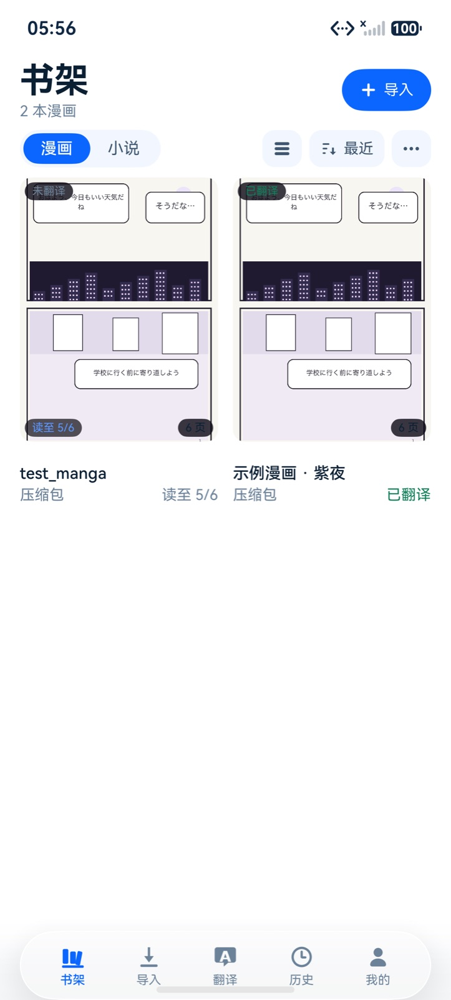
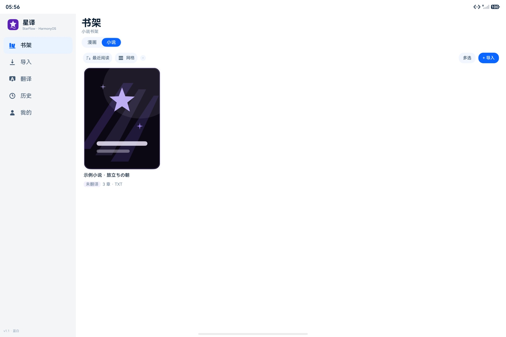
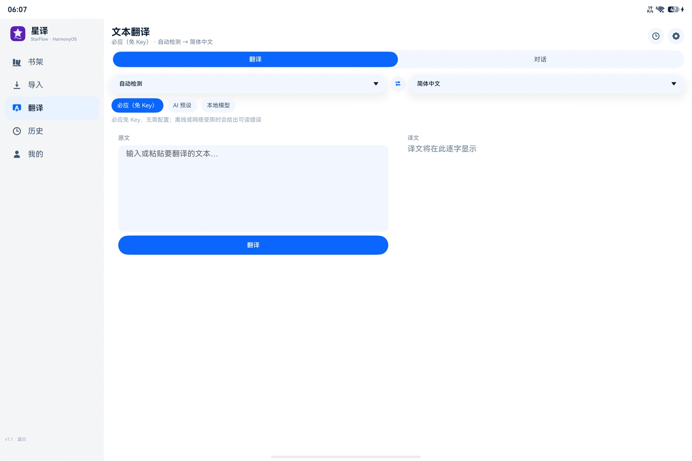
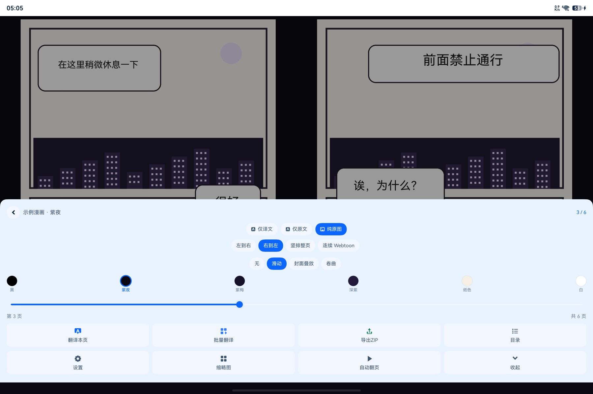
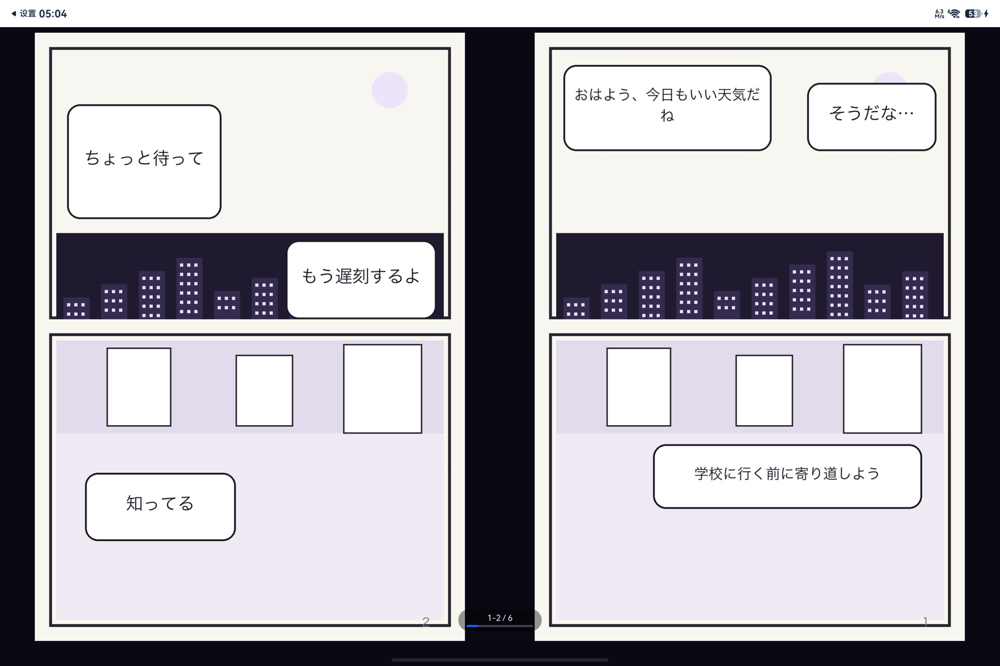
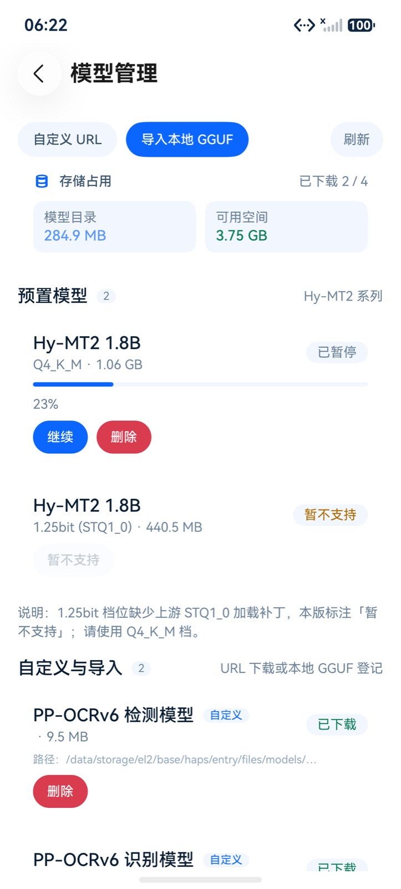
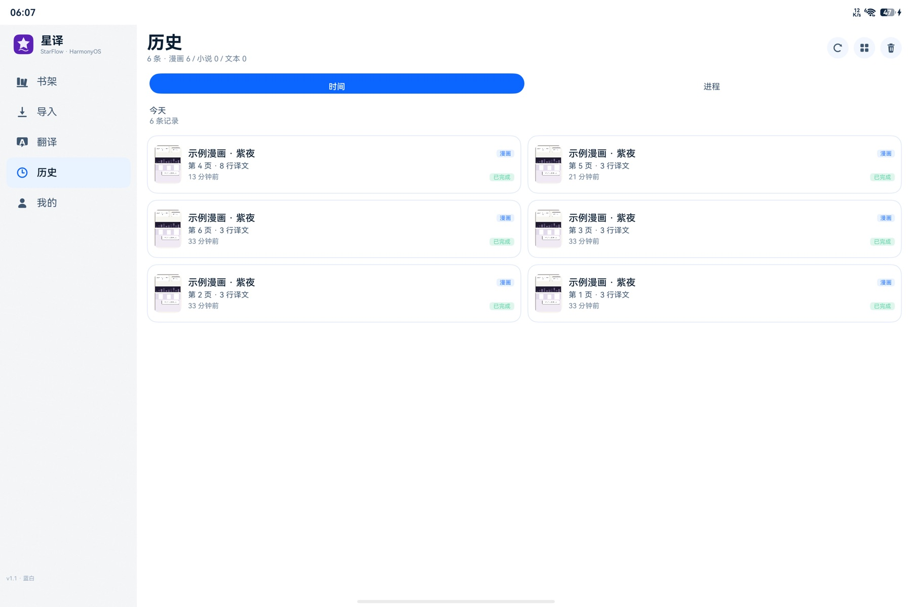

# 星译 StarFlow（HarmonyOS）

星译 StarFlow 是一个运行在 HarmonyOS 上的**漫画 / 小说 / 文本翻译工作台**：识别屏幕或图片中的文字，翻译后以覆盖层重新排版渲染回原图，同时提供小说阅读与整章翻译能力。翻译既可以走在线接口，也可以完全在端侧用内置的 llama.cpp 完成。

适配 **Phone / Tablet / 2in1**：手机使用底部沉浸光感 Tab，平板与宽屏自动切换左侧导航轨和双列/双页布局。

## 演示

<p align="center">
  
  
  
</p>

<p align="center">
  <b>手机书架</b> · <b>平板宽屏</b> · <b>文本翻译</b>
</p>

<p align="center">
  
</p>
<p align="center"><b>真机漫画 OCR：日文识别后中文译文回填</b></p>

| 原文 | 翻译后 |
|---|---|
|  |  |

<p align="center">
  
  
</p>
<p align="center"><b>模型管理 / 翻译历史</b></p>

> 截图来自 HarmonyOS 7.0.0（API 26）手机模拟器、平板模拟器与 PCE-W30 真机；详细测试记录见 [docs/TESTING.md](docs/TESTING.md)。

## 主要能力

- **漫画翻译**：Core Vision Kit 文字识别 → 版面分析 → 译文覆盖层渲染，支持阅读态与对照态
- **小说阅读**：TXT / EPUB / ZIP-HTML 解析、章节切分、分页器、阅读进度保存
- **翻译引擎**：统一 `Translator` 抽象，内置必应、OpenAI 兼容接口、本地 llama.cpp 三种实现；服务商预设含 DeepSeek、Kimi、硅基流动、通义千问、豆包、腾讯混元、MiniMax、智谱、OpenAI、自定义端点
- **预翻译/整本翻译**：可在阅读设置开启后台预翻译后续页/章（默认关闭，避免抢占首屏网络）；漫画书架「整本翻译」、小说菜单「整本翻译」可一次翻译整本
- **本地推理**：内置 llama.cpp（`entry/src/main/cpp/llama.cpp`），支持加载 GGUF 模型离线翻译；Hy-MT2 模型改走 ModelScope 国内镜像
- **OCR 本地模型**：设置→OCR 点任一模型会自动依次下载 det + rec 并启用本地档位；det 走 jsDelivr、rec 走 gh-proxy 加速（不随安装包分发），由 ONNX Runtime 鸿蒙 NAPI 本机推理；模型目录与缓存分片占用可在「模型管理」查看
- **渲染健壮性**：译文白块按页面像素边界裁剪，并限制在页面图像画布内，避免越界/错位
- **沉浸光感**：底部悬浮 Tabs + 27 个 NavDestination 标题栏 + Slider/Toggle 控件统一使用 API 26 `uiMaterial.ImmersiveMaterial`（ULTRA_THIN + interactive + lightEffect）；平板/2in1 使用左侧导航轨
- **蓝白配色**：蓝白为默认主题，另提供蓝黑夜间；已移除紫色主题，运行时切换并重建 shell
- **导入与分享**：支持从文件管理器拖入图片/压缩包、碰一碰接收文件导入、漫画多页「华为分享」（Share Kit）
- **本地优先**：已移除华为账号登录与云同步入口，书籍/进度/偏好仅保存在本机，不依赖账号；应用签名仍用于真机安装
- **文字方向自动**：覆盖层按每个 OCR 检测框的宽高逐块选择横排/竖排（横宽框→横排、竖长框→竖排），修复横向漫画译文被强制竖排导致的字距过大；设置中新增「自动」档
- **性能**：单页 OCR 后文本行 6 路并发翻译（本地 llama 串行）、页内行级译文缓存、本地 OCR 跳过重复解码、启动预热 OCR/GGUF；目标单页 5 秒内；Tabs 切换动画、阅读覆盖层排版计划缓存
- **数据层**：基于 RDB 的实体、DAO 与仓库封装

## 工程结构

```
StarFlowOhos/
├── AppScope/                # 应用级配置（bundleName: com.moe.starflow）
├── entry/                   # 主 HAP 模块：页面、视图、服务、C++ 推理
│   └── src/main/cpp/        # llama.cpp 及 JNI 封装
├── commons/                 # 主题 token、日志、自然排序等公共工具
├── coremodel/               # 数据实体、RdbHelper、DAO
├── corenovel/               # TXT/EPUB/ZIP-HTML 解析、章节切分、分页
├── coreocr/                 # 基于 Core Vision Kit 的 OCR 服务
├── corerender/              # 覆盖层几何计算、布局引擎、渲染器、FPS 统计
└── coretranslate/           # 翻译引擎：必应 / OpenAI 兼容 / 本地 llama
```

各模块之间通过 `oh-package.json5` 的本地依赖互相引用，`entry` 依赖全部 core* 模块。

## 语言构成

- 应用代码以华为 **ArkTS（`.ets`）** 为主（136 个文件、约 3.6 万行）；GitHub 通过 `.gitattributes`
  将 `*.ets` 按 **TypeScript** 统计，避免被误判为 Other。
- `entry/src/main/cpp/llama.cpp` 是 vendored 的上游 C/C++ 源码（llama.cpp），已在 `.gitattributes`
  标记 `linguist-vendored` / `linguist-detectable=false`，不计入本仓库语言比例。
- 其余为零星 C++ NAPI 桥接、SVG 图标与工程配置。

## 构建与运行

1. 安装 **DevEco Studio**（需要 HarmonyOS SDK **26.0.0**，`compatibleSdkVersion` / `targetSdkVersion` 均为 `26.0.0`）
2. 用 DevEco Studio 打开本目录，等待 `hvigor` 同步依赖（`ohpm install`）
3. 连接真机或启动模拟器，选择 `entry` 模块运行

命令行构建（DevEco Studio 6 / devecocli）：

```bash
# 推荐：devecocli 一键构建 debug HAP
devecocli build --build-mode debug

# 或使用 hvigor
hvigorw assembleHap --mode module -p product=default
```

产物：`entry/build/default/outputs/default/entry-default-signed.hap`

## 签名说明

当前 `build-profile.json5` 已用 CLI 生成的调试签名（`.p12/.cer/.p7b`，位于 `~/.ohos/config/`）。首次克隆或换机后执行：

```bash
devecocli auth login --no-prompt
cd /Users/kong/Desktop/StarFlowOhos
devecocli signature generate --force
```

签名配置会写入根目录 `build-profile.json5`。如果换过签名，设备上的旧包必须卸载一次，否则会报
`9568332 install sign info inconsistent`。

> 不要把 `.p12/.p7b/.cer`、密码或 AGC Client Secret 提交到仓库。

## 第三方组件与许可

- **StarFlow（星译 · Android 上游）** — [LGPL-3.0](https://github.com/xujunjiex/StarFlow)：本项目参照其信息架构、交互与视觉设计，在 HarmonyOS 上以 ArkTS 独立实现；不分发上游 Android 代码/二进制/模型。
- **llama.cpp** — [MIT](https://github.com/ggml-org/llama.cpp)：位于 `entry/src/main/cpp/llama.cpp`（vendored），许可全文见该目录下 `LICENSE`。
- **HarmonyOS SDK / Core Vision Kit / ArkUI** — 华为系统能力，按 HarmonyOS SDK 许可使用，不随仓库分发。
- 本仓库不包含 GGUF 模型文件；模型许可归各自发布方。

完整归属与许可文本见 [NOTICE.md](NOTICE.md) 与 [THIRD_PARTY_NOTICES.md](THIRD_PARTY_NOTICES.md)。

## 文档

- [docs/TESTING.md](docs/TESTING.md)：真机/模拟器测试记录、性能数据与已知限制
- [docs/BENCHMARK.md](docs/BENCHMARK.md)：OCR/翻译/排版质量与性能基准方法
- [softcopyright/README.md](softcopyright/README.md)：软件著作权申请材料包（说明书、源程序样本、权属/清单模板）
- [docs/images](docs/images/)：演示截图索引
- [skills/harmonyos-arkts-app-dev](skills/harmonyos-arkts-app-dev/)：本项目的全流程开发 skill 与坑位复盘
- [CHANGELOG.md](CHANGELOG.md)：版本变更记录

## 许可证

本项目以 **GNU Lesser General Public License v3.0（LGPL-3.0）** 发布，完整文本见 [LICENSE](LICENSE)。

上游 StarFlow 采用 LGPL-3.0；本项目保留其归属说明，并以相同许可证发布 HarmonyOS ArkTS 实现。
若分发修改版，请遵循 LGPL-3.0 关于源码提供、许可保留与修改说明的要求。
